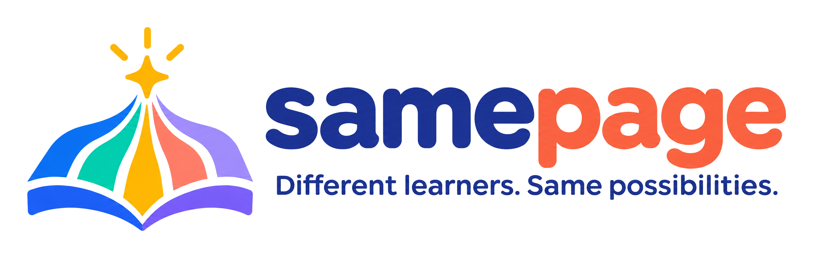
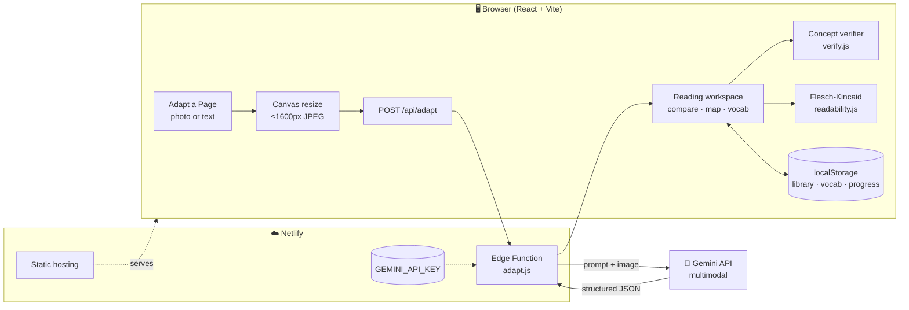
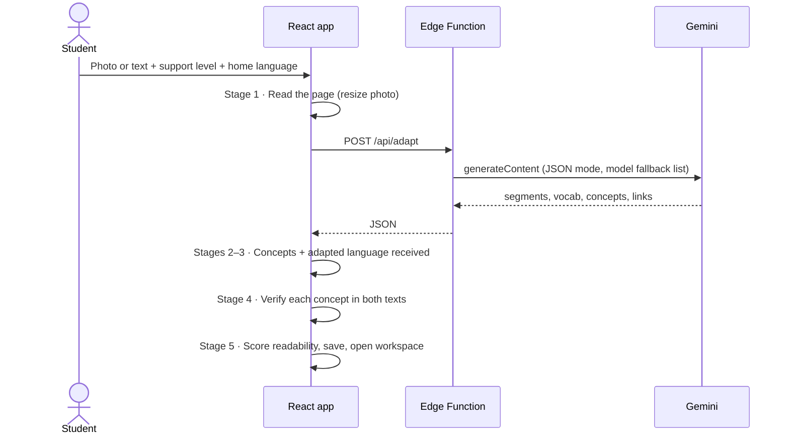

<p align="center">
  
</p>

<p align="center">
  <b>An adaptive textbook: snap any English textbook page and get it back at your reading level, explained in your home language, without losing the knowledge.</b>
</p>

<p align="center">
  <a href="#try-the-demo"><b>▶️ Try the demo</b></a> ·
  <a href="#architecture"><b>🏗️ Architecture</b></a> ·
  <a href="#run-locally"><b>⚙️ Run locally</b></a>
</p>

<p align="center">
  
  
  
  
  
  
</p>

---

## 💡 Inspiration

Picture a 7th grader who just moved to the United States from Venezuela. She's great at science, and back home she was at the top of her class. Now she's handed a textbook chapter on cell division written at a 10th-grade reading level in a language she's been learning for six months.

She doesn't need an easier class. She needs the **same** class she just can't read yet.

That's the gap for English language learners (ELLs): they're expected to learn grade-level content and a new language at the same time, usually with one ESL teacher stretched across a whole school. When they fall behind in history or biology, it usually isn't because the ideas are too hard. The words are just in the way.

And it's not just newcomers in the U.S. English is the language of most of the world's educational material. Schools across Africa, South and Southeast Asia, the Pacific Islands, Latin America and the Caribbean, and refugee communities in the Middle East receive donated English textbooks, learn from English-teaching volunteers and programs, or use free English resources online, because English materials are usually the easiest to get. Students there face the same problem: the knowledge is right in front of them, but the language locks it away.

**SamePage keeps every learner in the same lesson, on the same page.**

## ✨ What it does

SamePage isn't a translator or a summarizer. It's a reading workspace built around one rule: **the language changes, the knowledge doesn't.**

| | Feature | Why it matters |
|---|---|---|
| 📸 | **Capture any page** | Upload or photograph a textbook page, or paste a passage. Gemini's vision model transcribes photos. |
| 🪜 | **Five levels of language support** | Grades 2–3, 4–5, 6–7, 8–9 or the original. Levels describe how much help you get, not how smart you are. Switch any time while reading. |
| 📊 | **Measured readability** | A before → after score (e.g. `11.6 → 5.8`) calculated in the browser with the Flesch-Kincaid formula, not an AI's guess. |
| 🌍 | **26 home languages, three reading modes** | English, bilingual (each paragraph followed by its translation) or fully in your home language. Includes Swahili, Amharic, Yoruba, Dari, Pashto and other languages schools rarely support, with right-to-left layouts. |
| 🔤 | **Graduated word help** | Word translations under key terms → definitions on tap → independent reading. Students can take the support away as they grow. |
| 🧭 | **Original vs adapted, side by side** | Compare view lines up each original sentence with its adapted version. Hovering a sentence highlights its match in the other text. |
| ✅ | **Knowledge-retention check** | Each key concept is verified against **both** texts in the browser. The app shows `6 of 6 key concepts verified` only when the evidence is actually there. Otherwise it flags concepts as unverified or missing. |
| 🕸️ | **Knowledge map** | The key concepts as a connected map. Click a concept to jump to where the passage explains it. |
| ♿ | **Accessibility first** | Adjustable text size and line spacing, high-contrast mode, reduced motion, keyboard navigation, visible focus and screen-reader labels. |

<a id="try-the-demo"></a>

### ▶️ Try the demo

On the live site, click **Explore a demo** to open a photosynthesis lesson (Grades 4–5, explained in Español) that works without uploading anything.

## 🌍 SDG alignment

### SDG 4: Quality Education
Target **4.5** calls for equal access to education for vulnerable groups, and target **4.6** focuses on literacy. ELL students sit in the same classrooms as everyone else but often can't access the same material. SamePage turns any existing textbook into one they can read today, without separate "easy" materials that fall behind the curriculum.

### Making donated and free English materials actually usable
English textbooks are the most widely available learning materials in the world. Nonprofits ship donated books to schools abroad, open textbook libraries publish full courses for free online, and English-teaching programs bring English materials into classrooms. These only help if students can read them. With just a phone camera, SamePage turns a donated U.S. biology book into a Grade 4-level lesson with Swahili explanations, and no new books need to be printed.

### SDG 10: Reduced Inequalities
Target **10.2** is about the inclusion of all people regardless of origin. A student's home language shouldn't decide whether they learn biology. SamePage treats the home language as a **bridge** to English content, not a barrier.

### Who it's for
- **English learners in the U.S. and other English-speaking countries** (UK, Canada, Australia and more) keeping up in content classes
- **Students worldwide learning from English materials:** donated textbooks, English-teaching programs, and free resources online
- **Teachers** who need differentiated versions of a reading in seconds
- **Families** helping a student with homework in a language they're more comfortable with

<a id="architecture"></a>

## 🏗️ Architecture



### Request lifecycle



The processing screen only ticks a stage once that work has actually finished.

### Design decisions

- **Edge Function instead of a standard Netlify Function.** Standard functions are cut off after 10 seconds, and one adaptation returns a lot of structured data. Edge Functions don't have that limit. The API key stays on the server.
- **Sentence-aligned output.** The model returns the text as aligned `segments` (source → adapted → translation). One structure powers the reading view, bilingual mode, the compare view and hover-linking between the original and adapted panels.
- **Verify, don't trust.** The model quotes evidence for each concept from both texts, and `verify.js` checks that those quotes really appear before counting a concept as retained.
- **Cached versions.** Each level + language combination is fetched once and cached on the passage, so switching back is instant.
- **Model fallback.** The function tries `gemini-flash-latest` and then other Flash models, so a retired model name doesn't break the app.
- **No accounts.** Everything a student saves stays in their own browser, which also avoids collecting data from minors.

## 🧠 How the AI part works

One prompt asks Gemini for six things in a strict JSON shape:

1. Transcribe the page (for photos)
2. Split the original into short **segments**, in order
3. Adapt each segment to the chosen level (keeping every fact) and translate it into the home language
4. Pick **5–8 vocabulary words** with definitions, translations and example sentences
5. List **3–6 key concepts**, quoting the exact original and adapted sentences that carry each one
6. Describe **links** between concepts for the knowledge map

```jsonc
{
  "title": "How plants make food",
  "subject": "Science",
  "segments": [
    { "source": "Within the chloroplasts of leaf cells, the pigment chlorophyll absorbs sunlight.",
      "adapted": "Leaves have tiny parts called chloroplasts. Inside them, a green material called chlorophyll catches sunlight.",
      "translation": "Las hojas tienen partes muy pequeñas llamadas cloroplastos…", "new_paragraph": false }
  ],
  "vocab": [{ "word": "chlorophyll", "definition": "The green material in leaves that catches sunlight.", "translation": "clorofila", "definition_translated": "…", "example": "Chlorophyll makes leaves look green." }],
  "key_concepts": [{ "name": "Chlorophyll", "source_evidence": "Within the chloroplasts…", "adapted_evidence": "Inside them, a green material called chlorophyll catches sunlight." }],
  "concept_links": [{ "from": "Chlorophyll", "to": "Light becomes chemical energy", "label": "captures light" }]
}
```

### Readability formula

```
Grade = 0.39 × (words / sentences) + 11.8 × (syllables / words) − 15.59
```

The **Flesch-Kincaid Grade Level** is calibrated for English, which is one reason SamePage focuses on English source material: every reading level it reports is a real measurement.

## 🛠️ Tech stack

| Layer | Tech |
|---|---|
| **Frontend** | React 19, Vite 8, JavaScript, custom CSS design system (tokens, bento grid, no UI library) |
| **Backend** | Netlify Edge Functions |
| **AI** | Google Gemini API (Flash models with fallback): multimodal vision + text, JSON output mode |
| **Browser APIs** | Canvas (image resizing), localStorage |
| **Design** | Space Grotesk (headlines), Plus Jakarta Sans (interface), Lexend (reading), Lucide icons, custom SVG illustrations, a multicolor palette where each feature has its own color |
| **Hosting** | Netlify (auto-deploys from GitHub) |

## 📁 Project structure

Files are kept flat (no folders) so the project can be uploaded through GitHub's web uploader. The Netlify build step copies the edge function into `netlify/edge-functions/`.

```
index.html, main.jsx, App.jsx     App entry, shell (sidebar + top bar), hash router
styles.css                        Design tokens and all component styles
edge-simplify.js                  Edge Function: /api/adapt → Gemini
api.js                            Client call + response normalizing
verify.js                         Knowledge-retention verification
readability.js                    Flesch-Kincaid implementation
store.js                          localStorage store (library, vocab, settings)
passages.js, demo.js              Passage model, cached versions, demo lesson
Landing.jsx                       Landing page with interactive preview
Dashboard.jsx                     Student home (bento grid)
Adapt.jsx                         Upload / paste + real processing stages
Workspace.jsx                     Adaptive reading workspace (the core screen)
TextbookSpread.jsx                Landing-page live rewrite animation
KnowledgeMap.jsx                  Concept map
Library.jsx, Vocabulary.jsx       Saved pages, flashcards
Progress.jsx, Settings.jsx        Progress charts, accessibility settings
ui.jsx, Illustrations.jsx         Shared components, SVG illustration system
```

<a id="run-locally"></a>

## ⚙️ Run it locally

**Prerequisites:** Node.js 20+ and a free [Gemini API key](https://aistudio.google.com/apikey)

```bash
npm install
npm install -g netlify-cli
mkdir -p netlify/edge-functions && cp edge-simplify.js netlify/edge-functions/adapt.js
echo "GEMINI_API_KEY=your_key_here" > .env
netlify dev
```

The demo lesson works with plain `npm run dev` too, since it doesn't call the API.

| Variable | Required | Description |
|---|---|---|
| `GEMINI_API_KEY` | ✅ | Google AI Studio API key |
| `GEMINI_MODEL` | ❌ | Force a specific Gemini model |

## 📡 API

### `POST /api/adapt`

| Field | Type | Notes |
|---|---|---|
| `text` | string | Passage (40–8000 chars). Omit when sending `image`. |
| `image` | `{ data, mimeType }` | Base64 photo of a page |
| `level` | `2`, `4`, `6`, `8` or `"original"` | Amount of language support |
| `language` | string | Home language, e.g. `"Swahili"` |

## 🧗 Challenges we ran into

- **The 10-second wall.** The richer response (aligned segments, concepts, translations) took longer than standard Netlify Functions allow, so the API moved to an Edge Function.
- **Proving nothing was lost.** Asking the AI "did you keep everything?" proves nothing. Making it quote evidence and then checking those quotes in the browser turned retention into something we can actually show.
- **Aligning two versions of a text.** Sentence-level segments made compare view, bilingual mode and hover-linking all fall out of one data structure.
- **Right-to-left languages and non-Latin scripts** in every component that shows translated text.
- **Unicode-safe vocab highlighting** with `\p{L}` lookarounds, highlighting only the first appearance of each word.

## 🏆 Accomplishments we're proud of

- A real textbook photo becomes a leveled, bilingual, verified page in **one request**
- Retention and readability numbers that are **measured**, not claimed
- **26 home languages**, including many that schools rarely support

## 🚀 What's next

- **Teacher mode:** one reading → a class set at every level and language
- **Offline mode** for schools receiving donated books without reliable internet
- **Partner with book-donation nonprofits** so donated textbooks ship with a SamePage QR code
- **Pilot with ESL teachers** to measure reading gains

## 👩‍💻 Team

**Nikki Kothapalli** · **Natasha Kothapalli**

---

<p align="center">
  Built for the <b>Acodemic × KeebsforWater Global SDG Hackathon</b> 🌍<br />
  <i>Different learners. Same possibilities.</i><br />
  <sub>Supports UN Sustainable Development Goals 4 and 10. Not affiliated with or endorsed by the United Nations.</sub>
</p>
